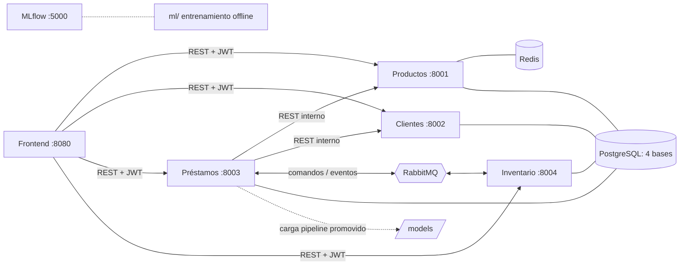

# CrediMarket

Plataforma de financiación de productos tecnológicos con cuatro microservicios (Productos, Clientes,
Préstamos e Inventario), frontend web, RabbitMQ, caché Redis y un modelo de riesgo con ciclo MLOps en MLflow.

```bash
./scripts/init-env.sh            # Windows: powershell -ExecutionPolicy Bypass -File .\scripts\init-env.ps1
docker compose up -d --build     # frontend en http://localhost:8080
```

Guía paso a paso: [docs/reproduccion.md](docs/reproduccion.md) · Demostración: [docs/guia_demo.md](docs/guia_demo.md)

## Autor

| Integrante | Responsabilidades |
|---|---|
| **Andrés David Pardo Álvarez** | Trabajo individual: diseño de la arquitectura, los cuatro microservicios (Productos, Clientes, Préstamos, Inventario), mensajería con RabbitMQ (outbox, idempotencia, DLQ), caché Redis, seguridad (JWT y roles), frontend, ciclo MLOps del modelo de riesgo (datos, experimentos en MLflow, selección, exportación, promoción, rollback y drift), Docker Compose, pruebas de aceptación y documentación |

### Cómo subir el proyecto al repositorio

```bash
git init && git branch -M main
git config user.name "Andrés David Pardo Álvarez"
git config user.email "<su correo de GitHub/GitLab>"
git remote add origin <url-del-repositorio>
# Commits por partes, para que el historial muestre cómo se construyó el sistema:
git add comun infra docker-compose.yml .env.example .gitignore .gitattributes .dockerignore scripts/init-env.* && git commit -m "Infraestructura base, librería común y configuración"
git add services/productos services/inventario docs/informe_redis.md && git commit -m "Productos, Inventario y caché Redis"
git add services/clientes frontend && git commit -m "Clientes, seguridad y frontend"
git add services/prestamos docs/decision_broker.md docs/maquina_estados.md docs/contratos && git commit -m "Préstamos, broker y contratos"
git add ml models mlops data && git commit -m "Datos, experimentos y modelo de riesgo"
git add . && git commit -m "Pruebas de aceptación, evidencias y documentación" && git push -u origin main
```

`.gitignore` ya excluye `.env`. Antes del primer push, `git status` no debe mostrar `.env`.

## Arquitectura en una imagen



Flujo: el cliente pide un préstamo con `Idempotency-Key`. Préstamos consulta al cliente y la cotización vigente
por API, calcula el monto, ejecuta el modelo y aplica reglas. Si el riesgo es favorable, guarda el estado
`PENDIENTE_INVENTARIO` y el comando `ReservaSolicitada` en un outbox, en la misma transacción, y responde
**202**. Inventario reserva de forma atómica y publica `InventarioReservado` o `InventarioInsuficiente`.
Préstamos pasa a `APROBADA` o `CANCELADA_SIN_STOCK`. La entrega y la cancelación siguen el mismo patrón.

## Estructura

```
services/            productos · clientes · prestamos · inventario  (FastAPI, un Dockerfile cada uno)
comun/               librería compartida: JWT/roles, BD, mensajería (outbox, consumidor, DLQ), CORS/errores
frontend/            SPA sin dependencias servida por nginx; config.js generado desde variables de entorno
ml/                  preparar_datos.py · entrenar.py · exportar.py · promover.py · credimarket_ml (features)
ml/reportes/         EDA e informe de selección (curvas de costo, matrices de confusión)
models/              v1, v2 (pipeline + manifiesto + ejemplos) · activo.json · historial_promociones.jsonl
mlops/mlflow/        historial de MLflow (SQLite + artefactos), montado por el contenedor mlflow
data/                CSV del enunciado + clientes_con_errores.csv (prueba de importación)
infra/postgres/      creación de las 4 bases y sus usuarios restringidos
scripts/             init-env, pruebas de aceptación, benchmark de caché, simulación de drift
docs/                arquitectura, decisiones, contratos, informes, guías y evidencias
```

## Documentación

| Documento | Contenido |
|---|---|
| [docs/arquitectura.md](docs/arquitectura.md) | Componentes, datos propios, diagramas de secuencia, despliegue |
| [docs/maquina_estados.md](docs/maquina_estados.md) | Estados, transiciones, tiempos de espera, eventos tardíos, vencimiento |
| [docs/decision_broker.md](docs/decision_broker.md) | RabbitMQ frente a Kafka: las seis preguntas, la configuración y cuándo cambiaríamos |
| [docs/contratos/rest.md](docs/contratos/rest.md) · [openapi/](docs/contratos/openapi/) | Contratos REST |
| [docs/contratos/mensajes/](docs/contratos/mensajes/README.md) | Sobre, tipos, JSON Schema y ejemplos de mensajes |
| [docs/informe_redis.md](docs/informe_redis.md) | Diseño de la caché, p50/p95, tasa de aciertos, fallos y recursos |
| [docs/ciclo_mlops.md](docs/ciclo_mlops.md) · [ml/reportes/](ml/reportes/) | Etapas A–F, selección, umbral, drift, promoción y rollback |
| [docs/guia_demo.md](docs/guia_demo.md) | Cuentas, recorrido en el navegador y las 16 pruebas de aceptación |
| [docs/reproduccion.md](docs/reproduccion.md) | Desde un clon limpio: comandos, puertos, configuración y experimentos |
| [docs/evidencias/](docs/evidencias/) | Salida de las pruebas, benchmark y drift |

## Pruebas

```bash
pip install -r scripts/requirements.txt
python scripts/pruebas/aceptacion.py     # 15 casos automáticos + vencimiento (opcional)
```

Los casos 14 y 15 (flujo y respuesta asíncrona en el frontend) se demuestran en el navegador según la guía.

## Seguridad

- No hay secretos en el repositorio: `.env` lo genera `scripts/init-env` y está en `.gitignore`.
- Cada servicio se conecta con un usuario de base de datos que solo tiene acceso a su propia base.
- La autorización se valida en el backend. El `cliente_id` siempre sale del token.
- El navegador solo habla con las APIs. No accede a bases de datos, Redis, el broker ni el modelo.

_Proyecto académico. Datos sintéticos; las decisiones del modelo no son recomendaciones financieras._
