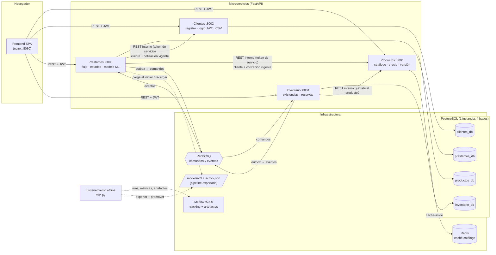
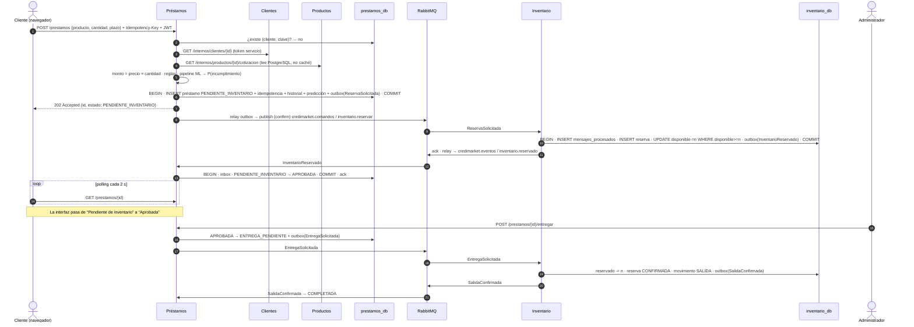
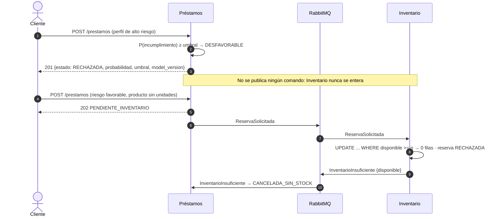
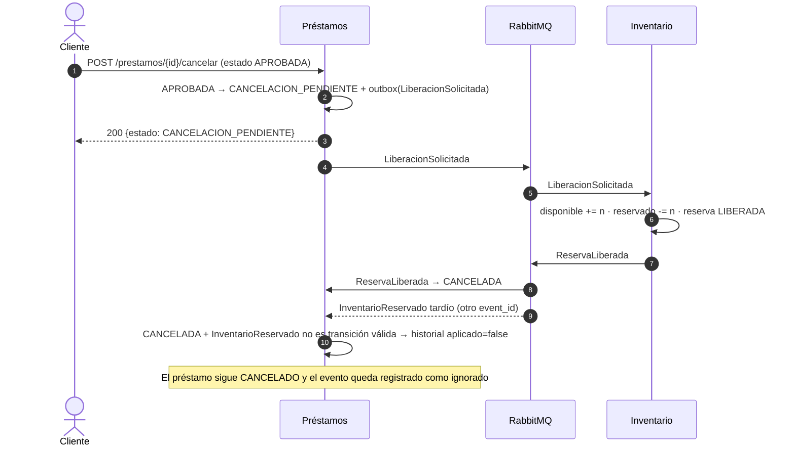
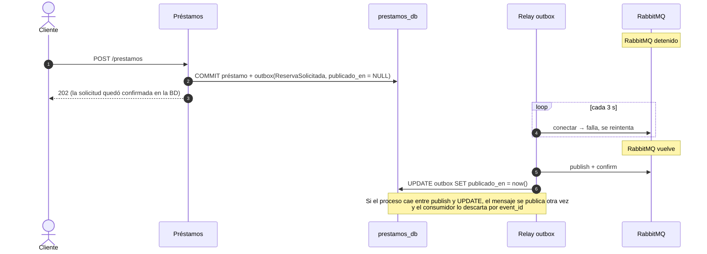
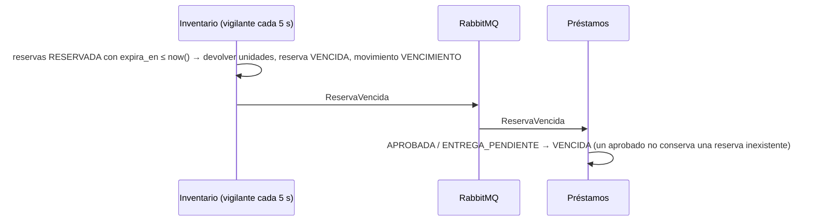

# Arquitectura de CrediMarket

CrediMarket financia productos tecnológicos. El sistema tiene cuatro microservicios de negocio, un frontend
web y una infraestructura compartida. RabbitMQ, Redis, PostgreSQL y MLflow son infraestructura, no servicios.
El entrenamiento del modelo es un proceso fuera de línea y no es un servicio.

## 1. Vista de componentes

Versión en imagen: [`diagramas/componentes.png`](diagramas/componentes.png).

### Responsabilidades y datos propios

| Servicio | Responsabilidad | Base de datos (usuario restringido) | Tablas |
|---|---|---|---|
| Productos | Crear, consultar, actualizar y desactivar productos. Gestiona precio, categoría y versión, con caché Redis. | `productos_db` (`productos_app`) | `productos`, `historial_precios` |
| Clientes | Registro, login (emite JWT), datos financieros y laborales, importación CSV. | `clientes_db` (`clientes_app`) | `clientes`, `usuarios`, `importaciones` |
| Préstamos | Recibe solicitudes, reúne datos por API, ejecuta el modelo, aplica reglas, gestiona estados y coordina reservas. | `prestamos_db` (`prestamos_app`) | `prestamos`, `idempotencia`, `historial_estados`, `predicciones`, `outbox`, `mensajes_procesados` |
| Inventario | Existencias, reserva atómica, confirmación de salida, liberación, vencimiento y movimientos. | `inventario_db` (`inventario_app`) | `existencias`, `reservas`, `movimientos`, `outbox`, `mensajes_procesados` |

- Se usa una sola instancia de PostgreSQL para ahorrar recursos. Cada servicio tiene su propia base lógica y un
  usuario que solo es dueño de esa base: `REVOKE ALL ... FROM PUBLIC` en `infra/postgres/01-crear-bases.sh`.
  Un servicio no puede ni siquiera conectarse a la base de otro.
- La comunicación entre servicios es solo por API REST (consultas síncronas de lectura) o por mensajes
  (coordinación de inventario). Ningún servicio lee tablas ajenas.
- El código compartido (`comun/credimarket_comun`) es una librería: autenticación, conexión a BD, mensajería y
  configuración web. No es un servicio.

## 2. Decisiones transversales

| Tema | Decisión | Dónde |
|---|---|---|
| Autenticación | Clientes emite un JWT HS256 (30 min) con los roles `cliente` y `admin`. Las llamadas internas usan un token de rol `servicio` de 5 min firmado con el mismo secreto. Cada servicio valida el token y el rol en el backend. | `comun/credimarket_comun/auth.py` |
| Autorización | Un cliente solo ve y cancela sus préstamos; si no es suyo recibe 403. El `cliente_id` sale del token, nunca del cuerpo de la petición. Los endpoints `/internos/*`, `/riesgo/predict`, `/cache/*`, la gestión de inventario y la de modelo exigen rol. | servicios |
| Secretos | Ninguno en el repositorio. `scripts/init-env` genera `.env` (ignorado por git) desde `.env.example`. | raíz |
| Idempotencia HTTP | Encabezado `Idempotency-Key`. `PRIMARY KEY (cliente_id, clave)` y hash del cuerpo. Misma clave y mismo cuerpo devuelven la misma solicitud; si el cuerpo cambia, la respuesta es 409. | `prestamos` |
| Publicación confiable | Outbox transaccional: el cambio de estado y el mensaje se guardan en la misma transacción, y un hilo relay (sondeo cada 0,3 s, lotes de 50 con `FOR UPDATE SKIP LOCKED`) publica con *publisher confirms*. | `mensajeria.py` |
| Idempotencia de mensajes | `mensajes_procesados(event_id PK)` se inserta en la misma transacción que el efecto. El `ack` se envía después del `COMMIT`. | `mensajeria.py` |
| Reserva atómica | `UPDATE existencias SET disponible = disponible - n ... WHERE disponible >= n`, más `CHECK (disponible >= 0)` y `UNIQUE (prestamo_id)` en reservas. | `inventario` |
| Caché | Redis cache-aside solo en Productos. El monto del préstamo se calcula con la cotización leída de PostgreSQL. | `productos` |
| Modelo | Préstamos carga el pipeline de la versión promovida (`models/activo.json`) al iniciar y verifica su SHA-256. Nunca se entrena por petición. | `prestamos/app/modelo.py` |

## 3. Diagramas de secuencia

### 3.1 Solicitud aprobada y entrega (flujo completo)

### 3.2 Rechazo por riesgo y falta de existencias

### 3.3 Cancelación y evento tardío

Si la liberación llega a Inventario antes que la reserva (por ejemplo, una cancelación por tiempo de espera),
Inventario crea una reserva "lápida" en estado `LIBERADA` con cantidad 0. Cuando después llegue
`ReservaSolicitada`, el `UNIQUE (prestamo_id)` impide reservar unidades para ese préstamo.

### 3.4 Caída del broker: outbox

### 3.5 Vencimiento de la reserva

## 4. Despliegue (Docker Compose)

| Contenedor | Imagen | Puerto host | Persistencia |
|---|---|---|---|
| frontend | nginx 1.27 + `config.js` generado desde variables de entorno | 8080 | — |
| productos / clientes / prestamos / inventario | python 3.13-slim, usuario no root | 8001–8004 | — (estado en PostgreSQL) |
| postgres | postgres:17-alpine | 127.0.0.1:5432 | volumen `pg_datos` |
| rabbitmq | rabbitmq:4.1-management | 127.0.0.1:5672, 127.0.0.1:15672 | volumen `rabbitmq_datos` |
| redis | redis:8-alpine, sin persistencia, 64 MB LRU | 127.0.0.1:6379 | — (es caché) |
| mlflow | mlflow 3.18.0 | 127.0.0.1:5000 | carpeta `mlops/mlflow` del repositorio |
| entrenamiento | perfil opcional `entrenamiento` | — | escribe en `models/`, `ml/` |

Los puertos de infraestructura se publican solo en `127.0.0.1` para que los scripts de prueba y las consolas
funcionen sin exponerlos a la red.
