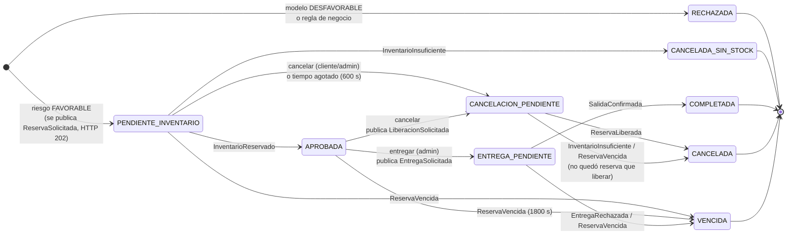

# Máquina de estados del préstamo

Implementación: `services/prestamos/app/estados.py` (tabla `TRANSICIONES`) y `_transicion()` en
`services/prestamos/app/main.py`. Cada cambio queda en `historial_estados` con el evento que lo produjo.

Versión en imagen: [`diagramas/maquina_estados.png`](diagramas/maquina_estados.png).

## Estados

| Estado | Tipo | Cuándo ocurre | Qué ve el cliente |
|---|---|---|---|
| `RECHAZADA` | final | El modelo da probabilidad ≥ umbral, o falla una regla: cliente inactivo, monto fuera de 300.000–15.000.000 COP, información financiera incompleta. | Motivo, probabilidad, umbral y versión del modelo. |
| `PENDIENTE_INVENTARIO` | intermedio | Riesgo favorable; se guardó `ReservaSolicitada` en el outbox. | "Pendiente": el riesgo favorable **no** es una aprobación. |
| `APROBADA` | intermedio | Inventario confirmó la reserva (`InventarioReservado`). | Reserva y fecha de vencimiento. |
| `CANCELADA_SIN_STOCK` | final | `InventarioInsuficiente`. | Unidades disponibles en el momento. |
| `ENTREGA_PENDIENTE` | intermedio, añadido | El administrador pidió la entrega; se espera `SalidaConfirmada`. Mientras tanto no se puede cancelar. | "Entrega en curso". |
| `COMPLETADA` | final | Inventario confirmó la salida. | Entregado. |
| `CANCELACION_PENDIENTE` | intermedio, añadido | Se pidió cancelar o se agotó el tiempo; se espera `ReservaLiberada`. | "Cancelando". |
| `CANCELADA` | final | Inventario liberó la reserva, o confirmó que no había ninguna. | Cancelada. |
| `VENCIDA` | final, añadido | La reserva expiró sin entrega, o la entrega se rechazó por falta de reserva activa. | Motivo del vencimiento. |

Los estados añadidos a los mínimos del enunciado existen porque cancelar y entregar dependen de una
confirmación asíncrona de Inventario. El enunciado exige que `CANCELADA` llegue **después** de liberar la
reserva y `COMPLETADA` **después** de confirmar la salida, así que hace falta un estado "esperando" entre la
orden y la confirmación.

## Tiempos de espera

| Tiempo | Valor | Variable | Dónde se aplica | Efecto |
|---|---|---|---|---|
| Espera de respuesta de Inventario | 600 s | `PENDIENTE_TIMEOUT_SEGUNDOS` | Préstamos (hilo `VigilanteTiempos`, cada 5 s) | `PENDIENTE_INVENTARIO` → `CANCELACION_PENDIENTE` con motivo "Sin respuesta de Inventario", y se publica `LiberacionSolicitada` por si la reserva llega a crearse. |
| Vigencia de una reserva | 1800 s | `RESERVA_TTL_SEGUNDOS` | Inventario (hilo `VigilanteReservas`, cada 5 s, y también al pedir la entrega) | La reserva pasa a `VENCIDA`, las unidades vuelven a disponible, se registra el movimiento `VENCIMIENTO` y se publica `ReservaVencida`; Préstamos pasa a `VENCIDA`. |
| Llamadas REST internas | 2 s | `TIMEOUT_HTTP_S` | Préstamos → Clientes y Productos | La solicitud responde 503 `dependencia_no_disponible`. No se crea préstamo ni se consume la clave de idempotencia. |
| Reintentos de un mensaje | 3 entregas | `MAX_REINTENTOS` | Consumidores y `x-delivery-limit` | Después, el mensaje va a `credimarket.dlq`. |
| TTL de caché del catálogo | 60 s | `CACHE_TTL_SEGUNDOS` | Productos | Límite de cuánto tiempo un dato del catálogo puede estar desactualizado (ver informe de Redis). |
| Sesión | 30 min | `SESION_MINUTOS` | Clientes (JWT) | 401 `sesion_vencida`; el frontend pide iniciar sesión de nuevo. |

Para demostrar el vencimiento sin esperar 30 minutos: poner `RESERVA_TTL_SEGUNDOS=60` en `.env` y ejecutar
`docker compose up -d inventario`. Se aprueba un préstamo, no se entrega y al minuto pasa a `VENCIDA`.

## Eventos tardíos o fuera de orden

**Regla:** si `(estado actual, evento)` no está en `TRANSICIONES`, el estado **no cambia**. El evento se
guarda en `historial_estados` con `aplicado = false` y en `mensajes_procesados` con resultado
`ignorado en <estado>`. Así se cumplen tres garantías:

- **Una confirmación de reserva que llega después de cancelar no reactiva el préstamo.**
  `(CANCELADA, InventarioReservado)` no es una transición válida. Además, la reserva ya está liberada o es una
  lápida en Inventario, así que no quedan unidades retenidas (prueba de aceptación 7).
- **Un evento duplicado no tiene doble efecto.** Lo frena primero `mensajes_procesados` y, si llega con otro
  `event_id`, la tabla de transiciones.
- **Si la liberación llega a Inventario antes que la reserva**, Inventario crea una reserva lápida (`LIBERADA`,
  cantidad 0). Cuando después llegue `ReservaSolicitada`, choca con `UNIQUE(prestamo_id)` y no reserva nada.
- **Si se pide liberar una reserva ya entregada (`CONFIRMADA`)**, se ignora: nunca se devuelven al stock unidades
  que ya salieron.

## Vencimiento de la reserva

Un préstamo `APROBADA` nunca conserva una reserva inexistente. Cuando la reserva vence, Inventario devuelve
las unidades y publica `ReservaVencida`, y Préstamos pasa a `VENCIDA`. Si el administrador intenta entregar
con la reserva ya vencida, Inventario la vence en ese momento. Si no encuentra una reserva activa, responde
`EntregaRechazada`. En los dos casos el préstamo termina en `VENCIDA` y no en `COMPLETADA`.
