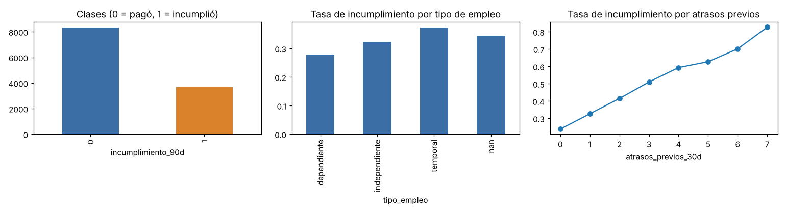

# Análisis exploratorio (etapa A)

- Archivo: `data/prestamos_entrenamiento.csv` — versión `prestamos_entrenamiento-v1`
- SHA-256: `c6cdc437c3aecc9116bc8b978df421d5a7600634c1ad7d6f82e58222a2446ecd`
- Filas: 12000, columnas: 15
- Proporción de la clase 1 (incumplió): 30.6%
- Duplicados por `solicitud_id`: 0; por `cliente_id`: 0 (cada cliente aparece una vez); filas idénticas: 0
- `tasa_mensual_simulada` toma un único valor [0.018]: se excluye.
- Problemas de validación: ninguno

## Faltantes

| Columna | Faltantes | % |
| --- | --- | --- |
| tipo_empleo | 93 | 0.8% |
| antiguedad_laboral_meses | 91 | 0.8% |
| meses_historial_crediticio | 97 | 0.8% |
| porcentaje_pago_puntual | 2473 | 20.6% |

`porcentaje_pago_puntual` falta cuando no hay créditos previos con historial: se imputa con la mediana de entrenamiento y se agrega un indicador `sin_historial_pago`.

## Rangos (numéricas)

|                            |          min |            50% |           max |
|:---------------------------|-------------:|---------------:|--------------:|
| ingresos_mensuales_cop     |      1.4e+06 |      3.905e+06 |   2.8e+07     |
| obligaciones_mensuales_cop |  11000       | 972000         |   1.6485e+07  |
| antiguedad_laboral_meses   |      0       |     31         | 240           |
| meses_historial_crediticio |      0       |     48         | 300           |
| creditos_previos           |      0       |      2         |  19           |
| atrasos_previos_30d        |      0       |      0         |  12           |
| porcentaje_pago_puntual    |     12.68    |     86.09      |  99.97        |
| monto_solicitado_cop       | 500000       |      3.2e+06   |   1.5e+07     |
| plazo_meses                |      6       |     18         |  36           |
| tasa_mensual_simulada      |      0.02    |      0.02      |   0.02        |
| cuota_estimada_cop         |  18991.9     | 214889         |   2.65984e+06 |
| incumplimiento_90d         |      0       |      0         |   1           |

## Relación con el objetivo

| Quintil de carga financiera ((obligaciones + cuota) / ingresos) | Tasa de incumplimiento |
| --- | --- |
| (0.013000000000000001, 0.208] | 17.9% |
| (0.208, 0.302] | 23.7% |
| (0.302, 0.402] | 27.5% |
| (0.402, 0.531] | 34.5% |
| (0.531, 2.07] | 49.2% |

| Plazo (meses) | Tasa de incumplimiento |
| --- | --- |
| 6 | 39.6% |
| 12 | 31.8% |
| 18 | 31.1% |
| 24 | 27.6% |
| 36 | 27.2% |

Sin historial de pago: 27.6% de incumplimiento; con historial: 31.3%.

## Solicitudes nuevas (solo inferencia)

- Filas: 200; sin variable objetivo, por lo que no permiten calcular métricas.
- Faltantes: {'tipo_empleo': 2, 'antiguedad_laboral_meses': 1, 'meses_historial_crediticio': 1, 'porcentaje_pago_puntual': 43}

