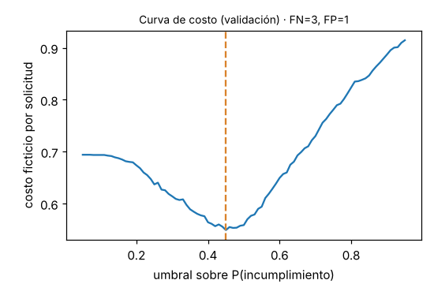
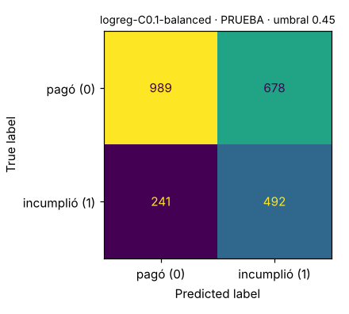

# Informe de selección del modelo (etapas B a D)

## Reglas fijadas antes de comparar

- Métrica de selección: **average precision (AP) de la clase 1 en validación**. Se prefiere a accuracy porque la clase 1 es el 30 % y lo que importa es ordenar bien el riesgo.
- Desempate: diferencia de AP menor a 0.005 → mayor ROC-AUC → menor Brier.
- Umbral: mínimo costo ficticio en validación con FN = 3 (aprobar a quien incumplirá) y FP = 1 (rechazar a quien habría pagado). Costos explícitos y no son una recomendación financiera.
- La partición de prueba se usó una sola vez, con los modelos y umbrales ya congelados.

## Comparación (validación, umbral 0,5 salvo AP, ROC-AUC y Brier)

| corrida              | algoritmo              |   val_AP |   val_ROC_AUC |   val_brier |   val_precision_1@0.5 |   val_recall_1@0.5 |   val_f1_1@0.5 |   cv_AP_entrenamiento |   entr_AP |
|:---------------------|:-----------------------|---------:|--------------:|------------:|----------------------:|-------------------:|---------------:|----------------------:|----------:|
| logreg-C1            | logistic_regression    |   0.5299 |        0.7037 |      0.1868 |                0.6159 |             0.2643 |         0.3699 |                0.5468 |    0.5514 |
| logreg-C0.1-balanced | logistic_regression    |   0.5295 |        0.7038 |      0.2157 |                0.4726 |             0.6226 |         0.5373 |                0.547  |    0.5512 |
| rf-d8                | random_forest          |   0.5193 |        0.6951 |      0.1894 |                0.6223 |             0.1975 |         0.2999 |                0.5273 |    0.6925 |
| hgb-lr0.05           | hist_gradient_boosting |   0.519  |        0.6918 |      0.1895 |                0.5965 |             0.2779 |         0.3792 |                0.5318 |    0.6454 |
| rf-d14               | random_forest          |   0.5136 |        0.6897 |      0.1901 |                0.605  |             0.2316 |         0.335  |                0.5248 |    0.9205 |
| arbol-d4             | decision_tree          |   0.4762 |        0.6775 |      0.1922 |                0.5608 |             0.2575 |         0.3529 |                0.4691 |    0.5064 |
| arbol-d8             | decision_tree          |   0.4589 |        0.6389 |      0.2086 |                0.5023 |             0.2929 |         0.3701 |                0.4581 |    0.623  |
| baseline-prior       | dummy                  |   0.3058 |        0.5    |      0.2123 |                0      |             0      |         0      |                0.3056 |    0.3056 |

Empatados dentro de la tolerancia: logreg-C0.1-balanced, logreg-C1. El desempate se decidió por ROC-AUC, tal como se fijó, aunque la diferencia es mínima; el modelo con pesos balanceados está peor calibrado (Brier más alto) porque desplaza las probabilidades hacia la clase 1. Como la decisión usa un umbral ajustado en validación sobre ese mismo modelo, el desplazamiento queda compensado en el umbral. Si el negocio necesitara probabilidades calibradas, la regla debería cambiarse antes de una nueva comparación.

## Modelo seleccionado: `logreg-C0.1-balanced` (versión v2)

- run_id: `5f3374c3386945a892571451ccbe3cc4`
- Umbral congelado: **0.45** sobre P(incumplimiento). Si P ≥ umbral, la decisión de riesgo es DESFAVORABLE. La decisión de riesgo no es la aprobación del préstamo: luego se aplican reglas de negocio y se reserva inventario.

| Métrica | Validación (umbral) | Prueba (umbral) |
| --- | --- | --- |
| average_precision | 0.530 | 0.526 |
| roc_auc | 0.704 | 0.692 |
| brier | 0.216 | 0.218 |
| precision_1 | 0.434 | 0.421 |
| recall_1 | 0.711 | 0.671 |
| f1_1 | 0.539 | 0.517 |
| tasa_rechazo | 0.502 | 0.487 |
| costo_por_solicitud | 0.549 | 0.584 |

Matriz de confusión en prueba: TN=989, FP=678, FN=241, TP=492.

 

## Versión anterior para promoción y rollback: `rf-d8` (versión v1)

- run_id: `5dd4239c8b4f454a8e8975deadebe489`, umbral 0.25. Prueba: AP 0.524, ROC-AUC 0.686, recall 0.727.
- Es el mejor candidato de un algoritmo distinto al seleccionado. Se exporta como v1 para demostrar la promoción v1 → v2 y el rollback con dos modelos que producen probabilidades distintas.

## Calibración

Se reporta el Brier score y la curva de calibración de cada corrida (artefacto `calibracion_validacion.png` en MLflow). La salida se interpreta como un puntaje ordenable con un umbral; no se afirma que represente el riesgo real de personas: los datos son sintéticos.
